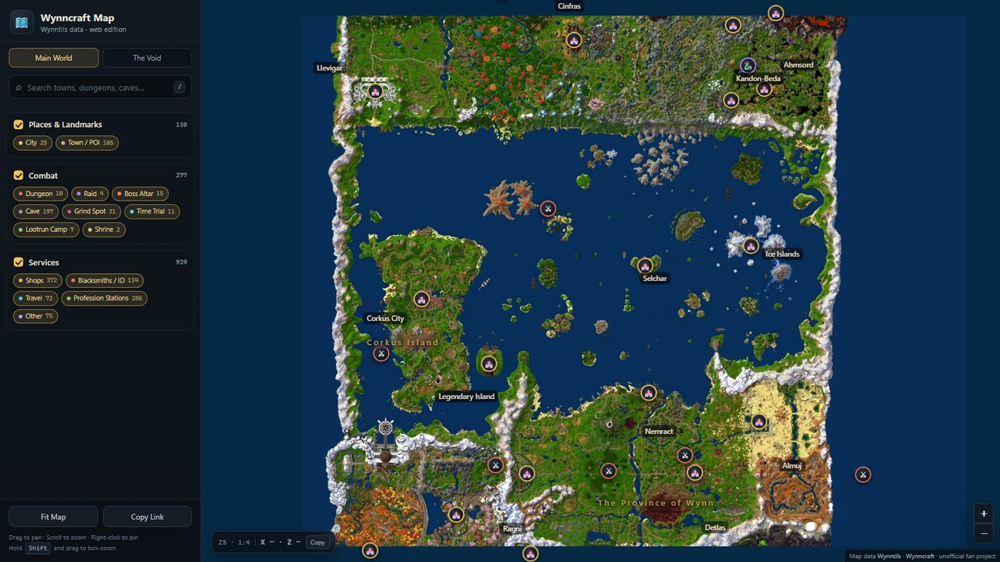

# Wynncraft Interactive Map · Wynntils web edition

A static, browser-based interactive map for [Wynncraft](https://wynncraft.com), built from the official **Wynntils** map tiles and point-of-interest data. No game client, no mod, no build step — just open the site.



## What's inside

| Page | Description |
| --- | --- |
| `index.html` | Main world — 4608 × 6144 blocks, 1 px = 1 block, zoom 1:128 → 1:1 (and beyond) |
| `void.html` | **The Void** — separate region with its own coordinates, tiles and POIs |

- **Places of interest:** cities & towns, dungeons, raids, boss altars, caves, grind spots, time trials, lootrun camps, shrines, 20 kinds of services (booths excluded)
- **Progressive disclosure:** cities and dungeons at low zoom, towns, services and minor POIs appear as you zoom in
- **Search** (`/` to focus), POI cards with level, exact coordinates, copy `/loc`, Wiki link
- **Share:** `#x=-819&z=-1581&zoom=7` restores the view; `?poi=Ragni` opens a specific POI
- **Map tools:** wheel zoom, drag, `Shift`-drag box zoom, right-click to drop a draggable pin
- **Mobile:** drawer sidebar, touch zoom
- All names and UI text are the original English strings

## Structure

```
index.html            main world map
void.html             The Void map
screenshot.jpg        preview image (README only)
.nojekyll             skip GitHub Pages' Jekyll processing
assets/               CSS + JS for both pages
data/                 map.json / pois.json / map-void.json / pois-void.json
tiles/                main world tiles (z2–z7, 256 px WebP, 584 files)
tiles-void/           Void tiles (45 files)
vendor/leaflet/       Leaflet 1.9.4, vendored locally (no external CDN)
```

## Deploy to GitHub Pages

1. Create a **public** repository and put the **contents of this folder** (not the folder itself) in the repository root
2. **Settings → Pages → Build and deployment**: Source = `Deploy from a branch`, Branch = `main` / `(root)`, Save
3. Wait 1–2 minutes, then open `https://<your-name>.github.io/<repo>/`

Notes:

- Every path is relative, so the site works from a user site (`<name>.github.io`) or a project sub-path (`/<repo>/`) without changes.
- No build step, no dependencies to install; this folder is the final artifact.
- `.nojekyll` is included so GitHub Pages serves the files as-is.
- Total size ≈ 11.3 MB (largest file ≈ 0.14 MB), well under Pages' 1 GB site / 100 MB file limits.
- There is no external network request at runtime apart from the site's own files.

## Data & updates

- Tiles and POIs come from Wynntils' public static storage:
  `https://cdn.wynntils.com/static/Reference/maps.json`, `.../Reference/maps/*.png`, and the
  `*_mapfeatures.json` files.
- This folder is a build artifact. To refresh the data, run the build scripts in the source project
  (`tools/build_tiles.py`, `tools/build_void_tiles.py`, `tools/build_pois.py`) and copy the regenerated
  `tiles/`, `tiles-void/`, `data/` and `assets/` back into this repository.
- Service locations come from Wynntils' community data and can become outdated; re-run the POI build
  for the latest snapshot.

## Notes

- Unofficial fan project. Map rendering and POI data belong to Wynntils / Wynncraft.
- The official ocean colour is a very vivid blue (`#0029d0`); the build tones it down to a deeper blue for readability. Land pixels are untouched.
- No live data (player positions, territory ownership, market prices) — static map and POIs only.
- The Void has only a handful of POIs (2 places, 1 time trial, 5 services); that is everything in Wynntils' public dataset.
